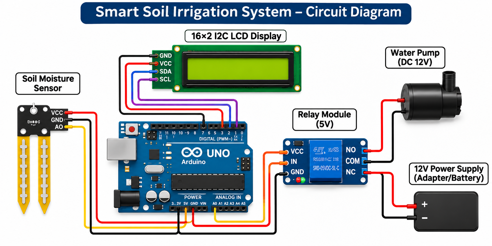

# Smart Soil Irrigation System

An automatic irrigation project that monitors soil moisture and controls water supply according to the soil condition.

## Project Overview

Plants need the right amount of water for healthy growth. This project uses a soil moisture sensor to monitor the moisture level and automatically controls a water pump when the soil becomes dry.

## Components Used

- Arduino UNO
- Soil Moisture Sensor
- Relay Module
- DC Water Pump
- External Power Supply
- Connecting Wires

## Working Principle

1. The soil moisture sensor measures the moisture level in the soil.
2. Arduino UNO reads the sensor value.
3. When the soil becomes dry, the relay activates the water pump.
4. Water is supplied to the plant.
5. When the required moisture level is reached, the pump turns OFF.

## Pin Connections

| Component | Arduino UNO |
|---|---|
| Soil Sensor AO | A0 |
| Relay IN | D7 |
| Sensor VCC | 5V |
| Sensor GND | GND |

## Circuit Diagram

## Arduino Source Code

[View Arduino Code](Smart-Soil-Irrigation.ino)

## Project Objective

- Reduce unnecessary water usage.
- Automate plant watering.
- Monitor soil moisture conditions.
- Make irrigation easier.

## Project Status

Prototype code and circuit documentation.

---

Thanks for visiting this project.
